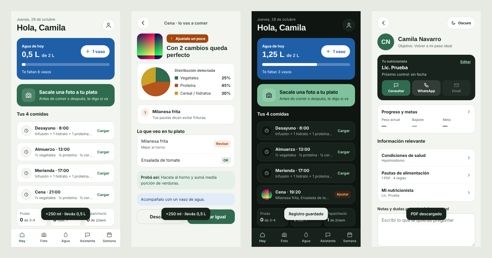

# 🥗 Mi Plato - Seguimiento de comidas

Aplicación web para hacer seguimiento de lo que comés siguiendo las pautas de tu nutricionista, desarrollada con **HTML5**, **CSS3** y **JavaScript**. Le sacás una foto al plato y la app, con la API de **Gemini**, te dice si está bien o qué ajustar según tus pautas. Funciona en el celular y en la computadora, con tu cuenta guardada en la nube (**Supabase**).

🌐 **Ver app en vivo:** https://mi-plato-cmno.vercel.app/


## 🚀 Características

* **Demo sin registrarse:** Desde el ingreso, "Probar la demo" abre la app con una semana de datos de ejemplo y platos ya analizados. No usa la IA ni guarda nada en la nube.
* **Cuenta en la nube:** Ingreso y registro con email y contraseña (Supabase Auth). Entrás desde cualquier dispositivo y ves los mismos datos; los cambios se sincronizan solos y, sin internet, se guardan y se suben cuando vuelve la conexión.
* **Apodo opcional:** si lo cargás, la app te saluda así.
* **Configuración inicial:** Condiciones de salud, alergias, datos de tu nutricionista y tu objetivo.
* **Mis comidas y límites:** Cada usuario tiene sus propias comidas (nombre, horario, guía y cómo se evalúa la foto) y sus límites a controlar (por ejemplo, huevo máx. 1 por día). Se arman solos a partir de los PDFs de pautas y se pueden editar.
* **Pautas en PDF:** Subís varios PDFs a la vez (hasta 25 MB cada uno). El texto se extrae en el celular y Gemini los lee todos en un solo pedido para armar tus reglas, que podés editar. Si te equivocás de archivo, lo eliminás y se van también sus reglas.
* **Análisis por foto:** Cámara a pantalla completa con guía para encuadrar el plato (o foto de la galería, o describirlo si no tenés foto). Elegís la comida y la hora, y la app te dice si "va bien" o "ajustalo", con la distribución del plato, lo que detectó y una sugerencia.
* **Comidas extra:** Colaciones, postres o algo que picaste fuera del plan, con su propio nombre y hora.
* **Agua diaria:** Seguimiento de los 2 L con vasos, recordatorios (cada 2 horas, con almuerzo y cena, y si vas atrasada) y festejo con confeti al cumplir la meta.
* **Mi semana:** Comidas "va bien" por día, límites semanales de tus pautas, actividad física y días con 2 L.
* **Actividad física:** Registrás cada entrenamiento con el tipo (gym, caminata, natación…), el día, los minutos y una nota; se puede editar o borrar y sale detallado en el PDF.
* **Exportar en PDF:** Resumen semanal con fotos para descargar o compartir con tu nutricionista.
* **Asistente:** Chat con Gemini para pedir recetas y consultar ingredientes, respondiendo según tus pautas.
* **Mi usuario:** Progreso de peso y medidas con gráfico, metas y acceso directo a tu nutricionista por WhatsApp o email.
* **Colores a elección:** 9 paletas (Salvia, Terracota, Petróleo, Lavanda, Ciruela, Frambuesa, Azul, Marrón y Mono, apta para daltónicos) guardadas en la cuenta, y modo claro, oscuro o automático.
* **Próximas mejoras:** Lista de mejoras para votar y formulario para sugerir nuevas; cada sugerencia se guarda en Supabase y llega por mail (Resend).
* **Se instala como app:** Con su ícono en la pantalla de inicio y a pantalla completa, sin pasar por ninguna tienda (iPhone: Compartir › "Agregar a inicio"; Android: menú › "Instalar app").
* **Celular y escritorio:** En el celular, barra de navegación abajo; en la computadora, menú lateral, pantallas a dos columnas y arrastrar y soltar la foto del plato.


## 🛠️ Tecnologías Utilizadas

* **HTML5:** Estructura de una sola página (SPA) con navegación por hash.
* **CSS3:** Variables CSS para los temas, Flexbox, Grid, `prefers-color-scheme` y `prefers-reduced-motion`.
* **JavaScript (Vanilla):** DOM, eventos, `fetch` y `async/await`, `localStorage`, Canvas (fotos y confeti), Web Crypto, Notifications y Web Share.
* **Gemini API:** Análisis de fotos, lectura de pautas y chat. Si un modelo está saturado o sin cuota, la función prueba con otro.
* **Supabase:** Autenticación y base de datos Postgres con Row Level Security (cada usuario solo accede a lo suyo).
* **Vercel:** Publicación del sitio y funciones serverless que protegen la clave de Gemini.
* **IndexedDB:** Copia local de las fotos para que la app abra rápido y funcione sin conexión.
* **pdf.js:** Lectura de los PDFs de pautas en el navegador.
* **jsPDF:** Generación del resumen semanal en PDF.


## 📸 Vista Previa




## 📁 Estructura

```
Mi-Plato/
├── index.html
├── css/styles.css
├── js/
│   ├── storage.js     # copia local de los datos, apodo y fechas
│   ├── nube.js        # cuenta y sincronización con Supabase
│   ├── fotos.js       # fotos de los platos (IndexedDB + nube)
│   ├── plan.js        # comidas y límites de cada usuario
│   ├── ui.js          # navegación, tema y utilidades
│   ├── api.js         # llamadas a /api/gemini, imágenes y PDFs
│   ├── auth.js        # ingreso, registro, salud, nutri y pautas
│   ├── hoy.js         # pantalla Hoy, agua, festejo y recordatorios
│   ├── comidas.js     # cargar foto y resultado
│   ├── semana.js      # semana y PDF
│   ├── chat.js        # asistente
│   ├── perfil.js      # mi usuario, progreso, metas y consultas
│   ├── mis-comidas.js # pantalla para editar comidas y límites
│   ├── actividad.js   # actividad física: registrar, editar y borrar
│   ├── temas.js       # paletas de colores y pantalla "Colores de la app"
│   ├── demo.js        # usuario de demo con datos de ejemplo
│   ├── mejoras.js     # próximas mejoras (votos) y sugerencias
│   └── app.js         # arranque
├── api/gemini.js      # función serverless de Gemini (solo usuarios logueados)
├── api/config.js      # le pasa a la app la URL y la clave pública de Supabase
├── api/sugerencia.js  # guarda las sugerencias y las manda por mail
├── img/demo/          # fotos de los platos de ejemplo
├── img/logo.svg       # logo de la app
├── img/iconos/        # íconos para la pestaña y la pantalla de inicio
├── manifest.webmanifest # nombre, colores e íconos de la app instalada
├── sw.js              # service worker mínimo (necesario para instalarla)
├── supabase.sql       # tablas y reglas de seguridad para Supabase
├── vercel.json        # tiempo máximo de la función
├── vista-previa.png
├── .env.example
└── .gitignore
```


## 📲 Instalar en el celular

Mi Plato se instala desde el navegador, sin pasar por ninguna tienda. Queda con su ícono en la pantalla de inicio y se abre a pantalla completa, como cualquier app.

**iPhone (con Safari, tiene que ser Safari)**
1. Entrá a [mi-plato-cmno.vercel.app](https://mi-plato-cmno.vercel.app/).
2. Tocá **Compartir** (el cuadrado con la flecha hacia arriba).
3. Elegí **"Agregar a inicio"** y después **Agregar**.

**Android (con Chrome)**
1. Entrá a [mi-plato-cmno.vercel.app](https://mi-plato-cmno.vercel.app/).
2. Tocá el menú **⋮**.
3. Elegí **"Instalar app"** o **"Agregar a la pantalla de inicio"**. A veces Chrome muestra solo un cartel abajo que dice **"Instalar"**.

Ingresás con la misma cuenta que en la compu y ves los mismos datos. Por ahora necesita internet para funcionar.


## ▶️ Cómo usar

1. Probar la demo, o crear una cuenta (con apodo, si querés) y completar salud, nutricionista y pautas en PDF.
2. En **Hoy**, tocar "Sacale una foto a tu plato", elegir la comida y la hora, y analizar. Para algo fuera del plan, "Cargar una comida extra".
3. Marcar el agua que vas tomando y activar los recordatorios.
4. En **Semana**, revisar cómo venís y exportar el PDF para tu nutricionista.
5. En **Asistente**, pedir recetas o preguntar por un ingrediente.
6. En **Mi usuario**, elegir los colores de la app, votar las próximas mejoras o sugerir una.


## 🔑 Configuración

**Supabase (cuenta y datos)**
1. Crear un proyecto en [supabase.com](https://supabase.com).
2. En **SQL Editor**, pegar el contenido de `supabase.sql` y ejecutarlo.
3. En **Authentication › URL Configuration**, poner la URL de la app como *Site URL*.
4. Opcional: en **Authentication › Sign In / Providers › Email**, desactivar *Confirm email* para entrar sin confirmar el mail.
5. En **Project Settings › API Keys**, copiar la URL del proyecto y la clave pública (*publishable* / *anon*).

**Gemini**
1. Crear una clave en [Google AI Studio](https://aistudio.google.com/apikey).

**Resend (sugerencias por mail)**
1. Crear una cuenta en [resend.com](https://resend.com) con el mail donde querés recibir las sugerencias.
2. En **API Keys**, crear una clave (empieza con `re_`).

**Vercel** (Settings › Environment Variables) y después **Redeploy**:

| Variable | Valor |
|---|---|
| `GEMINI_API_KEY` | clave de Gemini (Secret) |
| `SUPABASE_URL` | URL del proyecto de Supabase |
| `SUPABASE_ANON_KEY` | clave pública de Supabase |
| `RESEND_API_KEY` | clave de Resend (Secret) |
| `MAIL_SUGERENCIAS` | el mail de tu cuenta de Resend, donde llegan las sugerencias |

Root Directory del proyecto en Vercel: `Mi-Plato`. Para probar en tu compu: copiar `.env.example` como `.env.local`, completar y correr `vercel dev`.

Las sugerencias también quedan en Supabase › **Table Editor › sugerencias**. Para cambiar la lista de mejoras, editá `MEJORAS` en `js/mejoras.js`.

**Diagnóstico:** abrí [`/api/gemini`](https://mi-plato-cmno.vercel.app/api/gemini) en el navegador para ver si Gemini y Supabase están configurados (no muestra las claves).


## 📌 Nota

Proyecto con fines educativos. Los datos (incluida la salud) se guardan en la cuenta de Supabase de cada usuario, protegidos para que solo esa persona pueda verlos. Las respuestas de la IA son orientativas y no reemplazan la indicación de un profesional.
