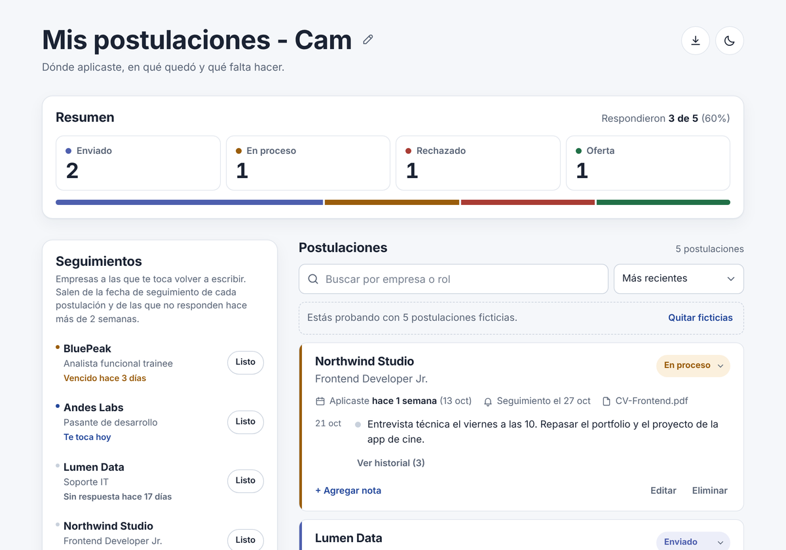

# 📋 Rastreador de Postulaciones

Aplicación web para organizar mi búsqueda laboral, desarrollada con **HTML5**, **CSS3** y **JavaScript**. Permite registrar a qué empresas apliqué, seguir en qué estado está cada proceso y guardar notas de seguimiento. Los datos quedan guardados en el navegador, sin login ni base de datos.

🌐 **Ver app en vivo:** https://rastreador-de-postulaciones.vercel.app/


## 🎯 Problema y usuario

* **Problema:** cuando mandás muchos CVs es fácil perder el hilo: a qué empresa le escribiste, en qué quedó cada proceso y qué te dijeron. Una planilla sirve, pero no muestra de un vistazo qué hay que hacer.
* **Usuario:** yo misma, y cualquier persona que esté buscando trabajo en tecnología y quiera tener sus postulaciones ordenadas.


## ✅ MVP: historias de usuario

| HU | Como usuaria quiero… | Criterio de aceptación | Estado |
|----|----------------------|------------------------|--------|
| HU1 | Agregar una postulación | Formulario con empresa, rol y fecha. Al confirmar, aparece en la lista. | ✅ |
| HU2 | Ver todas mis postulaciones | La lista muestra empresa, rol, fecha y estado. Si no hay ninguna, se muestra un mensaje que lo indica. | ✅ |
| HU3 | Cambiar el estado | Cada postulación tiene un selector con Enviado, En proceso, Rechazado y Oferta. El cambio se ve al instante. | ✅ |
| HU4 | Agregar notas | Cada postulación tiene su historial de notas con fecha. | ✅ |
| HU5 | Ver un resumen | Hay una sección con la cantidad de postulaciones por estado. | ✅ |

**Criterios generales:** los datos persisten al recargar (`localStorage`), la app funciona sin errores y está publicada en Vercel con URL pública. ✅


## 🧩 Alcance

**Fuera del MVP, por decisión:**
* **Login y usuarios:** la app es personal y los datos viven en el navegador.
* **Adjuntar archivos:** del CV se guarda solo el nombre del archivo, no el archivo.
* **Notificaciones del navegador:** en su lugar, la app muestra un panel de seguimientos al abrirla.
* **Importar desde LinkedIn:** se guarda el link de la vacante.

**Extras que agregué después de cumplir el MVP:** búsqueda, filtros, edición de postulaciones y fechas de seguimiento. Los detallo en Características.


## 🚀 Características

* **Bienvenida:** la app arranca en blanco y pide tu nombre. El encabezado queda como "Mis postulaciones - Cam", y el nombre se puede cambiar con el lápiz.
* **Resumen por estado:** cantidad por estado, barra de proporciones y porcentaje de empresas que respondieron. Tocar un estado filtra la lista.
* **Seguimientos:** lista las empresas a las que te toca volver a escribir: las que tienen la fecha de seguimiento vencida, para hoy o para la próxima semana, y las que no responden hace más de 2 semanas. Con **Listo** se marca como hecho.
* **Historial por postulación:** las notas tienen fecha y los cambios de estado se registran solos.
* **Festejo de oferta:** cuando una postulación pasa a "Oferta" aparece una felicitación con tu nombre y una animación de confeti.
* **Edición:** fecha, fecha de seguimiento, link de la vacante y nombre del CV enviado.
* **Búsqueda y orden:** por empresa o rol, y por fecha, empresa o próximo seguimiento.
* **Deshacer:** al eliminar una postulación se puede recuperar durante unos segundos.
* **Exportar e importar:** copia de respaldo en `.json` y archivo para Excel en `.csv`.
* **Postulaciones ficticias:** un botón carga 5 ejemplos para probar la app, y otro los quita sin tocar las postulaciones reales.
* **Tema claro y oscuro.**
* **Diseño Responsive:** pensado primero para el celular, en dos columnas desde 800 px.
* **Accesible:** se puede usar con teclado y tiene etiquetas para lectores de pantalla. Si el sistema tiene las animaciones reducidas, el confeti cae de forma suave.


## 🛠️ Tecnologías Utilizadas

* **HTML5:** estructura semántica y `<dialog>` para la felicitación.
* **CSS3:** CSS Grid, Flexbox, variables CSS para los temas claro y oscuro, y diseño mobile-first.
* **JavaScript (Vanilla):** manejo del DOM, eventos y `localStorage`. Exportación con `Blob` y animación de confeti con `Canvas`.
* **Google Fonts:** Bricolage Grotesque y Figtree.
* **Vercel:** publicación del sitio.


## 📸 Vista Previa




## ▶️ Cómo usar:

1. Entrar a la app y escribir tu nombre.
2. Cargar una postulación con empresa, rol, fecha y estado. Para probar rápido, tocar **Probar con postulaciones ficticias**.
3. Cambiar el estado desde el selector de cada tarjeta y sumar notas con **+ Agregar nota**.
4. Con **Editar**, ponerle una fecha de seguimiento. Va a aparecer en **Seguimientos** cuando se acerque.
5. Desde el botón de descarga del encabezado, exportar una copia o el archivo para Excel.


## 🤖 Trabajo con IA

### 3 prompts clave

1. **Definir el MVP:**
   > Necesito crear una app web HTML/CSS/JS para llevar el registro de mis postulaciones laborales. La app debe tener un formulario para agregar una postulación con empresa, rol y fecha, y una lista que muestre todas las postulaciones con empresa, rol, fecha y estado. El estado puede ser: Enviado, En proceso, Rechazado, Oferta. Si no hay postulaciones, mostrar un mensaje que lo indique. Usá un diseño limpio y mobile-first. Todavía no crees nada: posicionate en mi repositorio de GitHub.

2. **Pedir propuestas y verlas antes de aplicarlas:**
   > Quiero mejorar más la app, quiero tus propuestas y cómo se verían.

3. **Ajustar la experiencia con detalles concretos:**
   > Quiero que al cambiar el estado de la postulación a "Oferta" aparezca un mensaje de felicitación y, si es posible, una animación de confeti. Mostrar cómo quedaría.

### Errores y correcciones

* **El modo claro no funcionaba:** un selector mal escrito (`.root` en lugar de `:root`) dejaba sin colores el tema claro.
* **Editar una tarjeta perdía el foco:** cada letra volvía a dibujar la lista. Se reemplazó por un formulario de edición dentro de la tarjeta.
* **Los ejemplos volvían solos:** al borrar todo y recargar, reaparecían. Ahora la app distingue "nunca se usó" de "lista vacía".
* **El confeti no se veía en Windows:** con los efectos de animación desactivados, el navegador pide no animar. Se agregó una versión suave del confeti.
* **El panel "Para hacer" no se entendía:** pasó a llamarse "Seguimientos", con una explicación y el botón **Listo**.


## 🔁 v1 vs v2

| | v1: CineApp | v2: Rastreador de Postulaciones |
|---|---|---|
| **Uso** | Proyecto de práctica: una ticketera de cine | Herramienta que uso en mi búsqueda laboral |
| **Datos** | Horarios, salas y precios simulados | Mis propias postulaciones, que persisten al recargar |
| **Forma de trabajo** | Construir la app paso a paso | Partir del repo existente, pedir propuestas, verlas en capturas y elegir qué aplicar |


## 💭 Reflexión

En este proyecto aprendí a definir primero un MVP chico, con historias de usuario y criterios de aceptación, y a sumar mejoras recién cuando ese MVP estaba cumplido. A diferencia del v1, esta app la uso de verdad, y eso cambió lo que me importaba: que se entienda rápido, que no pierda datos y que me diga qué hacer. Con la IA trabajé más como revisora: le pedía propuestas, las veía en capturas antes de aplicarlas y señalaba lo que no funcionaba o no se entendía.


## 📁 Estructura

```
index.html        Estructura de la página
style.css         Estilos, temas claro y oscuro, diseño responsive
script.js         Lógica: bienvenida, postulaciones, resumen, seguimientos, historial, exportación y festejo
assets/vista-previa.png  Captura para este README
```


## 📌 Nota

Proyecto realizado en el Workshop de IA de AppDirect × Empujar (2026). Los datos se guardan solo en el navegador donde se cargan. Para pasarlos a otro dispositivo, usá **Exportar copia** e **Importar copia**.
